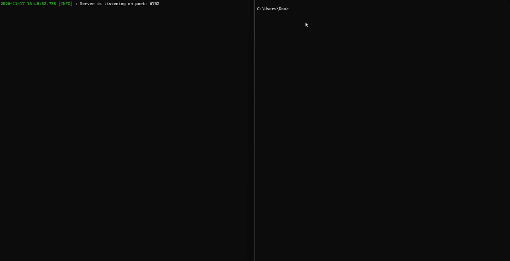

# winsock-http-server
## About
`winsock-http-server` is a personal implementation of **an** HTTP server in `C++` for learning purposes using **the** `winsock2` library that runs natively on **a** Windows machine. It responds to basic HTTP requests like:
- GET
- POST
- DELETE
- PUT
- PATCH  
  It handles query parameters from **URLs**, plain text, and **JSON** body types.
---
## Setup process
### Requirements
- Windows system
- `C++` version 20
- [`Cmake`](https://cmake.org/download/) version 4.3
- [`MinGW`](https://www.mingw-w64.org/downloads/) version 14.0

### Running program
1. Download http-server.zip from [Release](https://github.com/RexTi71/winsock-http-server/releases/tag/1.0.0)
2. Unzip it
3. Go to app folder and run `webserver.exe`

> To test out requests use `curl` command in `cmd` or `Postman`

---
## Gallery



---
## Example requests
GET Request
```
#Get all users
curl -X GET http://localhost:6702/users.json

#Get user with id=2
curl -X GET http://localhost:6702/users.json?id=2
```
POST Request
```
curl -X POST http://localhost:6702/users.json -H "Content-Type: application/json" -d "{\"age\": 28, \"password\": \"mypassword123\", \"username\": \"alice_dev\"}"
```
PATCH Request
```
curl -X PATCH http://localhost:6702/users.json?id=1 -H "Content-Type: application/json" -d "{\"age\": 29}"
```
PUT Request
```
curl -X PUT http://localhost:6702/users.json?id=1 -H "Content-Type: application/json" -d "{\"age\": 30, \"password\": \"newpassword123\", \"username\": \"alice_updated\"}"
```
DELETE Request
```
curl -X DELETE http://localhost:6702/users.json?id=1
```